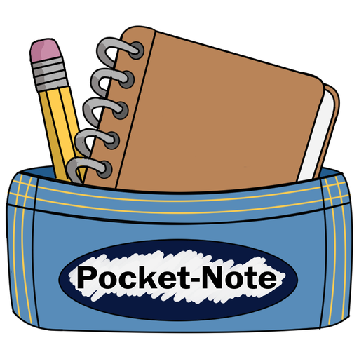

# Pocket-Note User Guide

Pocket-Note is a notebook app for Windows and Linux (and any modern browser) with rich-text pages, tables, free-form canvases, wiki links, folder sync and optional encryption. This guide covers everything you do day to day.

### Getting started

**Install.** On Windows, run the Pocket-Note installer (a portable version that needs no install is also provided). On Linux, use the AppImage or the .deb package. Pocket-Note then opens from your Start menu or applications list like any other app. Your notes are stored in your user profile folder, separate from the program, so updating or reinstalling never erases them.

**Your first notebook.** A notebook called My Notebook is created for you. Everything you need is in three panes:

1. **Sidebar** (left): search, a row of shortcut buttons, your notebooks and the page tree.

2. **Note list** (middle): every page in the selected section, newest first, with a preview.

3. **Editor** (right): the page you are working on, with its toolbar above it.

A fourth, optional **outline panel** on the far right lists the page's headings and the pages that link to it.

#### Three kinds of item
|Item|Use it for|
|---|---|
|Section|A folder that holds pages, canvases and more sections|
|Page|Rich text with tables, images, to-dos and attachments|
|Canvas|A free-form board for mind maps, flowcharts and storyboards|

Click any item to open it. Type its title in the box at the top of the page; the tree and note list update as you type.

### The workspace

**Sidebar.** The search box (Ctrl+K) is at the top. Under it a row of shortcut buttons opens the command palette, today's daily note, the graph view, tags, templates, reminders and the trash. Below that are the notebook menu (rename, icon, lock, delete, sync, import and settings buttons), the list of notebooks, Collapse all / Expand all, and the page tree. A Favourites block appears above the tree once you have starred a page. The buttons at the bottom create a Section, a Page or a Canvas.

**Note list.** Shows the pages of the section you are in. Sort by modified, created or title, and use the New page button at the top. Sub-pages appear nested with an arrow; a Back row takes you up a level. Drag a note onto another note or onto the tree to nest it.

**Editor.** A true rich-text page: what you see is what is saved. The page icon, favourite star, title and lock button sit in the header; tags and any reminder sit just under the title.

**Outline and linked mentions.** Click Outline in the status bar to show or hide the righthand panel. It lists Heading 1 to 3 as a live table of contents (click one to jump), and below it lists every page that links to the current page.

**Status bar.** Shows the page path, word and character count, and when the page was last modified.

**Resizing and text size.** Drag the thin edge of the sidebar or note list to change its width; double-click the edge to reset it. The Aa button at the foot of the sidebar and at the top of the note list cycles the text and icon size of that list through small, normal, large and extra large. Your choices are remembered.

**Zoom.** The zoom control (minus, percentage, plus) sits at the right of the page toolbar. Ctrl plus the mouse wheel also zooms the current page; click the percentage to return to 100%.

### Writing pages

Pages are true rich text, with no Markdown preview or split view.

**Formatting.** The toolbar above the page covers undo and redo, cut, copy and paste, text style (headings and normal text), bold, italic, underline, strikethrough, highlight, lists, todo items, toggles, quotes, code and a table of contents. Markdown-style shortcuts work too: typing # at the start of a line makes a heading.

**Slash menu.** Type / on an empty line to pick a block: tables, headings, to-do, bulleted and numbered lists, toggle, table of contents, quote, code block, divider, image and four callouts. Keep typing to filter and press Enter to insert.

**Callouts.** Choose Callout: info, warning, tip or danger from the slash menu to turn the current paragraph into a coloured box with an icon. Pick another callout type on the same block to change it.

**Tables.** Insert a table from the toolbar or slash menu. Click a cell to type, use the controls on the table to add or remove rows and columns, and toggle the header row.

**Images.** Paste an image (Ctrl+V), drag one onto the page, or use Attach. Click an image for resize and alignment controls.

**Floating boxes (OneNote style).** Drag text or an image to an empty part of the page to drop it as a movable box you can place and resize anywhere. Normal inline flow stays available.

**Page templates.** Open Templates (the page icon in the sidebar shortcut row, or the command palette) to start from Meeting notes, To-do list, Journal entry, Project plan or Weekly review, or from your own. To make your own, open a page and choose Save page as template in the command palette.

**Copy and paste.** Content pasted from web pages keeps basic formatting and is cleaned for safety.

**Spell check.** Misspelled words get a wavy red underline. Right-click for suggestions or to add a word to your dictionary. Choose UK or US English in Settings.

**Attachments.** Use Attach to add files to a page. They are listed at the bottom and travel with the page when you sync or back up.

### Organising

**Notebooks.** Each notebook has its own page tree, name and icon. Switch notebooks from the notebook list in the sidebar, and add one with New notebook. Tick all notebooks beside the search box to search across every notebook.

**Sections, pages and sub-pages.** Sections can hold pages, canvases and other sections to any depth, and any page can have sub-pages. Right-click an item in the tree or note list for a menu: add a sub-page, sub-canvas or sub-section; rename; make it a sub-page of the item above; move it out one level; move it to the top level; move up or down; delete.

**Drag and drop.** Drag any item in the tree or the note list and drop it:

on the top edge of another item to place it before it,

on the bottom edge to place it after it,

on the middle to nest it inside (the target becomes a section if needed).

Hovering over a collapsed section while dragging opens it so you can drop inside. The order you create is the order that is saved and synced.

**Tabs.** Opening an item adds a tab along the top. Click the x on a tab to close it; the item itself is not deleted.

**Icons.** Notebooks, sections, pages and canvases can each have their own icon. Click the icon button next to the page title (or the smiley button in the notebook menu) to open the icon picker: choose an emoji from categories or type your own, make a coloured letter tile, or upload a picture (cropped to a square and shrunk so your notes stay small). Reset puts the default back.

**Favourites.** Click the star beside a page title to add it to the Favourites block at the top of the sidebar, across all notebooks.

**Tags.** Type a tag into the plus tag box under the page title and press Enter. Click a tag to search for it, or search #tagname yourself. The tag button in the sidebar lists every tag with its count.

**Daily notes.** The calendar button (or Alt+D) opens today's note, creating it inside a Daily notes section the first time. Right-click the button for a month calendar; days with a note are marked with a dot.

**Trash.** Deleting a page or section moves it, with everything inside, to the Trash. Open the trash from the sidebar to Restore items, delete one forever, or empty the trash.

**Search.** Press Ctrl+K to jump to the search box. Results cover titles, page text, tags, table cells, canvas cards, shape text and attachment names. Click a result to open it; for canvas cards the view centres on the matching card. Press Esc or the x to clear.

### Linking and finding

**Wiki links.** Type [[ in a page and a list of your pages appears; keep typing to filter, then press Enter or Tab to link. If no page matches, choose Create to make it. Links are clickable chips: click one to open the page. A link to a page that does not exist yet is shown dashed; clicking it creates the page. If you rename a page, links to it follow the new name. Text such as [[Page]], [[Page|shown text]] or [[Page#Heading]] (from Obsidian, for example) is turned into links when you open the page.

**Linked mentions.** The outline panel lists every page that links to the one you are reading, with a short snippet of the surrounding text. Click one to open it.

**Graph view.** The graph button (or Ctrl+Shift+G) draws your pages as dots joined by their links. Drag a dot to move it, hover to highlight its neighbours, click to open the page. Tick all notebooks to include every notebook.

**Command palette.** Press Ctrl+P to run any command or jump to a page by typing part of its name. Ctrl+O is the same list limited to pages. Commands include new page, canvas or section; templates; daily note and calendar; graph; tags; trash; reminders; theme; outline;

note list; readable width; settings; import; and, for the open page, favourite, change icon, rename, reminder, history, save as template, callouts and move to trash. Use the arrow keys and Enter, or click.

**Page history.** Choose Page history in the command palette. Pocket-Note saves versions of a page automatically as you edit (up to 15, roughly one every few minutes). Pick a version to preview its text and Restore it; the version you replaced stays in the history.

**Reminders.** Choose Set reminder for this page in the command palette, pick a date and time, and a small card appears (with a system notification if you allowed it) when it is due, while Pocket-Note is open. You can open the page, snooze for 10 minutes or dismiss it. The reminder shows as a chip under the title, and the bell button in the sidebar lists all of them.

### Canvas pages

A canvas is an endless board. Drag the empty background to pan, scroll the wheel to zoom toward the pointer, and press Fit to see everything. Create one with Canvas at the bottom of the sidebar.

#### What you can put on it
|Toolbar button|Adds|
|---|---|
|Note, Text, To-do, Link, Image|Cards: sticky notes, free text, checklists, link cards, pictures|
|Board|A dashed group area; cards sit on top of it|
|Frame|A numbered 16:9 storyboard frame with an image and a caption|
|Shapes|15 diagram shapes (rectangle, diamond, cylinder, cloud and more) plus any from add-ons|

Cards have a grey bar on top: drag the bar to move the card, use the arrow to add a connected child, and the x to delete. Shapes have no bar: drag them by the body, and double-click (or press Enter or F2) to type inside them. Press Enter to finish; Shift+Enter makes a new line.

**Connecting things.** Click an item and four blue dots appear on its sides. Drag a dot onto another item to connect them, onto empty space to create a new connected shape, or click a dot to add a connected shape beside it. Click a line to change it from the bar under the toolbar: straight, elbow or curved; arrow at the end, start or both; solid, dashed or

dotted; colour, thickness and a label. Selected shapes get a corner handle to resize, and the bar offers shape type, fill, outline and text colours, font size, bold, duplicate, bring to front, send to back and delete.

**Mind maps.** Insert the Mind map template or draw a central shape. Select a shape and press Tab to add a child, Ctrl+Enter for a sibling. Turn on Mind map in the style bar for curved branches, and choose Layout, then Mind map to tidy everything onto both sides of the centre.

**Flowcharts.** Use Terminator for start and end, Rectangle for steps, Diamond for decisions and Parallelogram for input or output. Set lines to Elbow and label the branches Yes and No.

**Storyboards.** Press Frame to add numbered frames; each lands beside the last and wraps after four. Click a frame's image area to choose a picture, or paste or drop one onto it, then write the scene notes in the caption. Numbers follow reading order, so rearranging frames renumbers them.

**Templates and layout.** Templates inserts a ready-made diagram: mind map, flowchart, storyboard, Kanban, SWOT or org chart, plus add-on templates. Layout auto-arranges connected items as a tree (left to right or top to bottom) or a two-sided mind map; with an item selected, only items connected from it move.

**Helpful controls.** Undo and redo (Ctrl+Z, Ctrl+Y) cover every canvas change. Snap locks movement and resizing to a 24 px grid. Paste drops a copied image or text onto the canvas or the selected frame, and dragging image files works too. Delete removes the selection, Ctrl+D duplicates, and arrow keys nudge (Shift for bigger steps). Export saves PNG, SVG (opens in draw.io or Inkscape), a Markdown outline or a print/PDF view, and can save the diagram as a reusable template.

### Importing from other apps and files

Click the import button (the down arrow in the notebook menu), or choose Import in Settings or the command palette, then pick files or drop them onto the window. PocketNote recognises the format by itself and converts the content to its own pages.

|Source|What to give Pocket-Note|What you get|
|---|---|---|
|Obsidian|The vault folder or a zip of it|Folders become sections, notes become pages, images are kept, [[links]] become live links|
|Logseq|The graph folder or a zip of it|Pages and journals as pages, outline bullets as lists|

|Source|What to give Pocket-Note|What you get|
|---|---|---|
|Joplin|A JEX export (File, Export all, JEX)|Notebooks, sub-notebooks, notes, images and tags|
|Evernote|One or more .enex files|A notebook per file, with checklists, images and tags|
|Trilium|A zip export (Export subtree, HTML or Markdown)|The note tree as sections and pages|
|OneNote|Export to Word (.docx) or PDF first|See documents below; OneNote's own format cannot be read|
|Word, PDF, web pages|.docx, .pdf, .html, .htm, .mht files|One page per file|
|Markdown and text|.md, .txt files|One page per file|

**Word documents.** Headings, lists, bold and italic, tables and pictures are converted. A long document can be split into one page per top-level heading.

**PDFs.** Text is rebuilt into headings, paragraphs and lists, and repeated page headers and footers are dropped. Scanned PDFs, which contain only pictures of pages, are imported as images; multi-column layouts are read in a single column. In the browser version the PDF reader is downloaded the first time you import a PDF, so that needs an internet connection once; the desktop app includes it.

**Tags and links.** Tags from Evernote and Joplin become tags on the page. Obsidian wiki links become Pocket-Note links when you open the page.

**Tip.** Import into a fresh notebook first, check the result, then move pages where you want them. Take a backup before a large import.

### Sync, encryption and backup

**Syncing across devices.** Pocket-Note syncs through an ordinary folder. Put that folder inside Dropbox, OneDrive, Google Drive, Syncthing or a network share, and every device pointed at it stays up to date.

1. Click the cloud button in the notebook menu and choose Sync between devices.

2. Choose the sync folder (the desktop app opens a native folder picker).

3. Repeat on each device, selecting the same folder.

4. Tick Sync automatically, or choose Sync now to run it by hand.

Sync compares each device's changes with the folder and merges them. If two devices edit the same page at once nothing is lost: one version is kept as a conflicted copy for you to review. Pictures are stored once, so the folder stays small. If the cloud button shows a problem, hover over it to read the message; the usual cause is the cloud app not having finished uploading yet.

**Encrypting a page or section.** Use the lock button in a page's header (or the lock in the notebook menu for a whole notebook) to protect it with a password. The content is scrambled before it is saved or synced and the password is never stored. A forgotten password cannot be recovered.

**Encrypting the sync folder.** When you connect a folder you can also set a sync password so the files in your cloud folder are unreadable without it. Use the same password on every device.

**Backups.** Export a Pocket-Note backup (.json) from Settings regularly and keep a copy off the computer. Import the same file to restore, or to move to a new machine. Tags, favourites, reminders, page history, templates and the trash are all included.

### Add-ons and export

**Add-ons.** Add-ons give Pocket-Note extra shapes, diagram templates and toolbar buttons. If someone gives you an add-on file (its name ends in .json), open Settings, choose Import plugin (.json) and pick the file. Its shapes appear in the canvas Shapes menu, its templates in Templates and its buttons on the page toolbar. Remove an add-on with the x beside its name in Settings. Only import files from people you trust.

A ready-made add-on called Diagram extras adds 8 shapes (chevron, pentagon, plus, heart, folded note, person, callout, banner) and 5 templates (user journey, decision tree, 3- act storyboard, project timeline, cause and effect). To reuse one of your own diagrams, open the canvas and choose Export, then Save as template; import the saved file on any device to get it in your Templates menu.

#### Exporting.
Markdown: export the selected page or the whole notebook from Settings. Canvases export as an outline.

- PDF and print: use the print option; canvases print as a picture of the diagram. Canvas image: PNG or SVG from the canvas Export menu.

Backup: the .json backup in Settings holds everything.

### Customising

Open Settings (the gear in the notebook menu, or the command palette).

**Theme.** Switch between light and dark.

**Interface colour.** Choose a preset (Violet, Ocean, Forest, Rose, Sunset, Slate, Teal or Gold), or set your own accent, sidebar and background colours with the colour pickers. The accent colours buttons, selections, tags and links. Sidebar and background colours apply to light mode; dark mode uses a darkened version. Reset returns to the default Violet.

**Layout.** Drag the edges of the sidebar and note list to resize them, use Aa on each list for text size, show or hide the sidebar, note list and outline panel, and turn on Toggle readable line width in the command palette to keep page text in a comfortable column instead of full width.

**Icons.** Give every notebook, section, page and canvas its own icon (see Organising).

**Language.** Choose UK or US English for spell check.

### Shortcuts and troubleshooting

#### Keyboard shortcuts
|Where|Keys|Action|
|---|---|---|
|Anywhere|Ctrl+K|Focus the search box|
|Anywhere|Ctrl+P|Command palette (commands and pages)|
|Anywhere|Ctrl+O|Jump to a page|
|Anywhere|Ctrl+Shift+G|Graph view|
|Anywhere|Alt+D|Open today's daily note|
|Anywhere|Esc|Close a dialog or the palette|
|Pages|Ctrl+Z / Ctrl+Y|Undo / redo|
|Pages|Ctrl+B / I / U|Bold / italic / underline|
|Pages|Ctrl+Shift+H|Highlight|
|Pages|Ctrl+scroll|Zoom the page|
|Pages|Ctrl+click on a web link|Open the link|
|Pages|/|Open the block menu|

|Where|Keys|Action|
|---|---|---|
|Pages|[[|Link to another page|
|Canvas|Ctrl+Z / Ctrl+Y|Undo / redo|
|Canvas|Tab|Add a connected child|
|Canvas|Ctrl+Enter|Add a sibling|
|Canvas|Enter or F2|Edit the selected shape's text|
|Canvas|Delete|Delete the selected item or line|
|Canvas|Ctrl+D|Duplicate|
|Canvas|Arrow keys|Nudge (Shift for larger steps)|
|Canvas|Esc|Deselect|
|**roublesho** Problem|**oting**|What to do|
|The sideba|r is missing|Use the show/hide sidebar button at the top left|
|The note lis|t or outline is missing|Use the note list button at the bottom of the sidebar, or Outline in the status bar|
|A page I de|leted is gone|Open the Trash from the sidebar and Restore it|
|I overwrote|some text|Open Page history from the command palette and restore an earlier version|
|A link show|s dashed|The page it points to does not exist yet; click it to create it|
|Sync shows|a warning|Hover over the cloud button to read the message, and check your cloud app has finished uploading the folder|
|Sync asks f|or a password|Reconnect the folder and enter the sync password you use on your other devices|
|Windows s unknown|ays the publisher is|Choose More info, then Run anyway|
|An import f|inds nothing|Check the file type in the Importing table; for OneNote, export to Word or PDF first|

#### Troubleshooting
|Problem|What to do|
|---|---|
|A PDF will not import in the browser|The reader needs an internet connection the first time; try again online|
|An add-on will not import|Make sure you picked the right .json file from a source you trust|
|Canvas PNG export fails|Export as SVG instead|
|A page will not open|It may be encrypted; click it and enter its password|
|A note seems to be missing|Look for a conflicted copy in the same section, check the Trash, or restore from your latest backup|

About, licence and credits

Pocket-Note is released under the MIT License. The LICENSE and THIRD-PARTY-NOTICES files are installed with the app and list the open-source components it uses, including pdf.js for PDF import.

Author: Pocket-Designs (pocket-designs@proton.me). GitHub: github.com/Pocket-Designs.

Icon artist: MJO-Art (workmjo@gmail.com). The product icon files are custom images created by MJO-Art for this project. These icons cannot be altered or used without the express permission of the artist.

#### Pocket-Note User Guide - OneNote-style features
These features were added after comparing Pocket-Note with Microsoft OneNote. Most live in a second toolbar row under the normal one, and every one is also in the command palette (Ctrl+P).

#### Formatting row
- **Font** and **Size**: select text first, then pick from the lists.

- **A** (text colour): pick a swatch, Automatic, or a custom colour.

- **Superscript / subscript** buttons (x with a small 2 above or below).

- **Format painter**: select formatted text, click the brush, then select other text to copy the look onto it.

- **Clear formatting** (broom): removes colours, sizes, alignment and indent, and turns headings back into normal text.

- **Align** left, centre, right, justify; **Indent** / outdent (lists nest as sub-items).

#### Drawing and highlighting
Click **Draw** (on text pages and canvas pages). Choose Pen, Highlighter or Eraser, a colour and a thickness, then draw with a mouse, pen or finger. Undo steps back (Ctrl+Z), Clear all ink wipes the page, Done or Esc stops drawing. Drawings are saved with the page and sync with it. The eraser removes whole strokes.

#### Note tags
Click in a line and use **Tag**: To Do, Important, Question, Remember for later, Idea, Critical, Definition, Contact, Phone number, Address. Shortcuts: Ctrl+1 To Do, Ctrl+2 Important, Ctrl+3 Question. Click a To Do icon to tick it. **Tags** (Find tags) lists every tagged line in all notebooks, filtered by tag, with a "hide completed" option; click a row to jump to the line.

#### Page style
**Page** menu: rule lines (narrow, college, wide), grid (small, large), dots, and a page colour. Text switches to a readable colour on dark page colours.

#### Insert
- **Date and time** menu, or Ctrl+Alt+D (date) and Ctrl+Alt+T (time). Each page also shows when it was created and last edited under its title.

- **Equation** (or type /equation): write LaTeX-style text such as \frac{a}{b}, \sqrt{x}, x^{2}, \sum_{i=1}^{n}, Greek letters like \alpha, or use the symbol buttons. Click an equation to edit it.

- **Record**: records from the microphone and adds an audio player to the page. Click again to stop.

#### Other
- **Read**: reads the page, or the selected text, aloud. Click again to stop. It uses the voices installed on your computer.

- **Email**: opens your mail program with the page text.

- **Quick note** (lightning button, or Ctrl+Alt+N): creates a new page in a "Quick Notes" section. In the desktop app Ctrl+Alt+N also works from any other program.

#### Shortcuts added
|Keys|Action|
|---|---|
|Ctrl+1 / Ctrl+2 / Ctrl+3|Tag the line: To Do / Important / Question|
|Ctrl+Alt+D|Insert today's date|
|Ctrl+Alt+T|Insert the current time|
|Ctrl+Alt+N|New quick note (works from any program in the desktop app)|
|Esc|Stop drawing|
|Ctrl+Z (while drawing)|Undo the last stroke|

#### Not included
Handwriting-to-text, ink-to-math, screen clipping, dictation and translation need online services and are not part of Pocket-Note.
